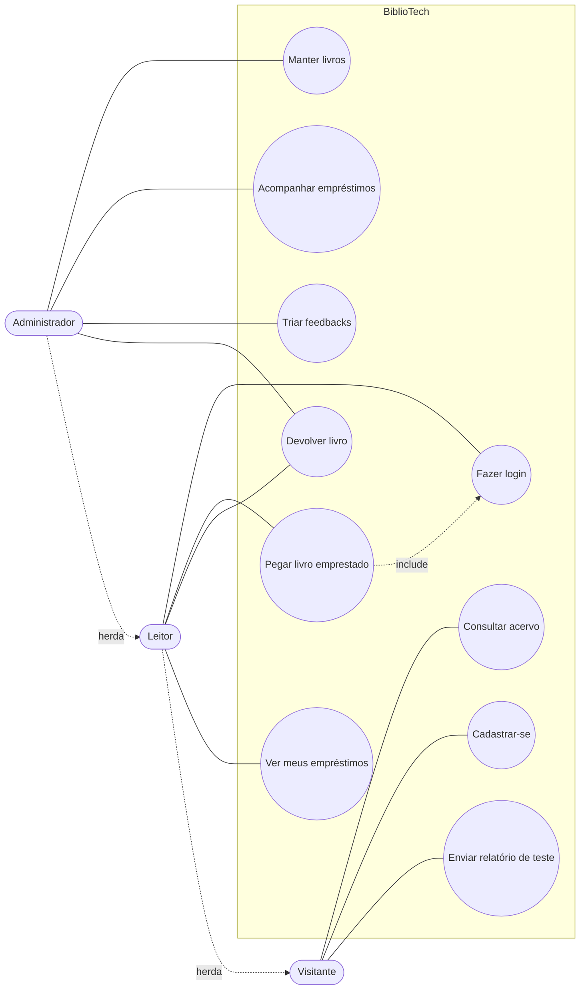
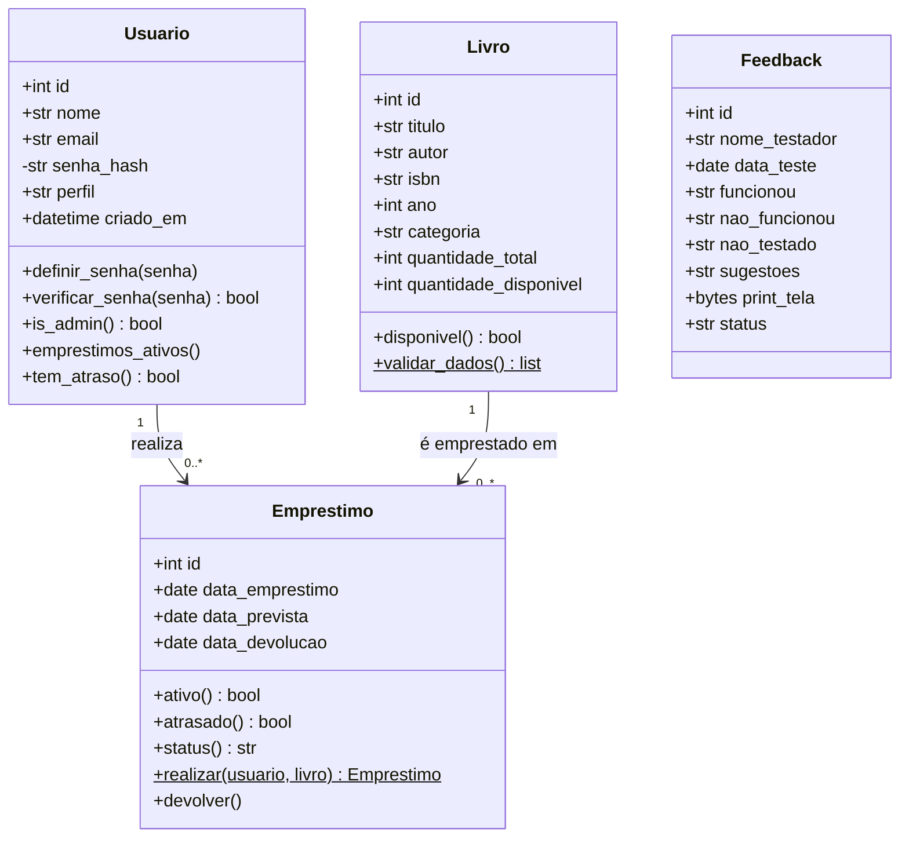
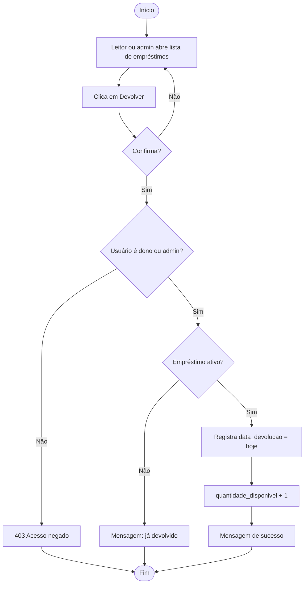

# 2. Modelagem UML

> Os diagramas estão em [Mermaid](https://mermaid.js.org/), que o GitHub desenha automaticamente ao abrir este arquivo.

## 2.1 Diagrama de casos de uso



## 2.2 Caso de uso expandido: UC4 Pegar livro emprestado

| Campo | Descrição |
|---|---|
| Ator | Leitor |
| Pré-condição | Leitor autenticado |
| Pós-condição | Empréstimo criado com data prevista = hoje + 14 dias; estoque decrementado |
| **Fluxo principal** | 1. Leitor abre o detalhe do livro. 2. Clica em "Pegar emprestado". 3. Sistema valida RN02, RN03, RN04 e RN05. 4. Sistema registra o empréstimo e diminui a quantidade disponível. 5. Sistema exibe "Empréstimo realizado! Devolva até dd/mm/aaaa". |
| FA1: sem exemplar | Em 3, se não há exemplar: exibe "Não há exemplares disponíveis deste livro." |
| FA2: atraso | Em 3, se o leitor tem atraso: exibe "Você possui empréstimo em atraso…" |
| FA3: limite | Em 3, se já tem 3 ativos: exibe "Limite de 3 empréstimos ativos atingido." |
| FA4: duplicidade | Em 3, se já está com o título: exibe "Você já está com um exemplar deste livro." |

## 2.3 Diagrama de classes (persistência)



## 2.4 Diagrama de sequência: realizar empréstimo (MVC)

```mermaid
sequenceDiagram
    actor L as Leitor
    participant V as View (detalhe.html)
    participant C as Controller (emprestimos.solicitar)
    participant M as Model (Emprestimo)
    participant DB as PostgreSQL

    L->>V: clica "Pegar emprestado"
    V->>C: POST /emprestimos/solicitar/{id}
    C->>DB: busca Livro
    C->>M: Emprestimo.realizar(usuario, livro)
    M->>DB: conta empréstimos ativos / atrasados
    alt regra violada
        M-->>C: RegraNegocioError(msg)
        C-->>V: flash(msg, "erro") + redirect
    else tudo ok
        M->>DB: INSERT emprestimo; UPDATE livro
        M-->>C: Emprestimo
        C-->>V: flash("Empréstimo realizado…") + redirect
    end
    V-->>L: mensagem na tela
```

## 2.5 Diagrama de atividades: devolução


