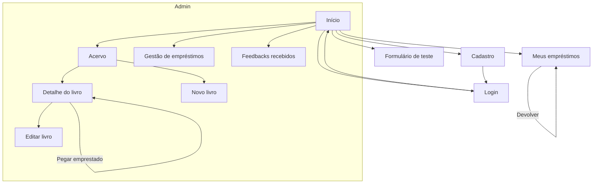
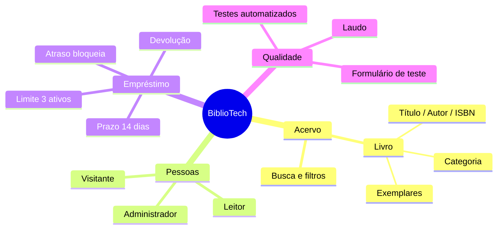

# 3. IHC: telas, mensagens e navegação

## 3.1 Mapa navegacional

## 3.2 Mapa conceitual

## 3.3 Princípios aplicados

| Princípio (heurísticas de Nielsen) | Onde aparece |
|---|---|
| Visibilidade do status | Etiquetas coloridas "Disponível / Indisponível / Atrasado"; data de devolução sempre visível |
| Prevenção de erros | Botão "Pegar emprestado" desabilitado quando não há exemplar; confirmação antes de excluir/devolver |
| Mensagens claras | Toda regra violada gera mensagem em português dizendo o que fazer (veja 3.4) |
| Consistência | Mesmo layout, cores e posição dos botões em todas as telas |
| Flexibilidade | Busca rápida na home e no acervo; filtros por categoria |
| Design responsivo | Menu hambúrguer e tabelas em formato de cartão abaixo de 720 px |

## 3.4 Catálogo de mensagens

| Situação | Tipo | Mensagem |
|---|---|---|
| Cadastro ok | Sucesso | Cadastro realizado! Faça login para continuar. |
| E-mail repetido | Erro | Este e-mail já está cadastrado. |
| Senhas diferentes | Erro | As senhas não conferem. |
| Senha curta | Erro | A senha deve ter pelo menos 6 caracteres. |
| Login inválido | Erro | E-mail ou senha incorretos. |
| Rota protegida | Aviso | Faça login para acessar esta página. |
| Empréstimo ok | Sucesso | Empréstimo realizado! Devolva até dd/mm/aaaa. |
| Sem exemplar | Erro | Não há exemplares disponíveis deste livro. |
| Atraso | Erro | Você possui empréstimo em atraso. Devolva-o antes de pegar outro livro. |
| Limite | Erro | Limite de 3 empréstimos ativos atingido. |
| ISBN inválido | Erro | ISBN deve ter 10 ou 13 dígitos numéricos. |
| Excluir com histórico | Erro | Não é possível excluir: o livro possui histórico de empréstimos. |
| 403 | Página | Você não tem permissão para acessar esta página. |
| 404 | Página | Página não encontrada. |
| Upload > 2 MB | Página | Arquivo muito grande. O limite é 2 MB. |

## 3.5 Protótipo

O protótipo evoluiu para a aplicação funcionando. As capturas de tela estão em [`../situacao-2-codificacao/telas/`](../situacao-2-codificacao/telas/).
