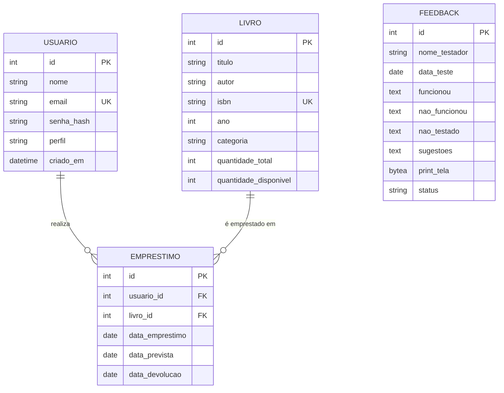

# 4. Projeto de banco de dados

SGBD escolhido: **PostgreSQL**, que é popular, gratuito, tem suporte nativo no Render e é fácil de manter. Em desenvolvimento e nos testes usamos SQLite, sem mudar o código, porque o acesso é feito pelo ORM SQLAlchemy.

## 4.1 Modelo conceitual (DER)

## 4.2 Modelo lógico normalizado

- **USUARIO** (<u>id</u>, nome, email, senha_hash, perfil, criado_em)
- **LIVRO** (<u>id</u>, titulo, autor, isbn, ano, categoria, quantidade_total, quantidade_disponivel)
- **EMPRESTIMO** (<u>id</u>, *usuario_id* → USUARIO, *livro_id* → LIVRO, data_emprestimo, data_prevista, data_devolucao)
- **FEEDBACK** (<u>id</u>, nome_testador, data_teste, funcionou, nao_funcionou, nao_testado, sugestoes, print_tela, print_mimetype, status, criado_em)

**Normalização**

- **1FN:** todos os atributos são atômicos. Por exemplo, "autor" é um texto único por livro, sem listas dentro do campo.
- **2FN:** todas as chaves primárias são simples (`id`), então não existe dependência parcial.
- **3FN:** não há dependência transitiva. Dados do leitor e do livro ficam nas próprias tabelas, e EMPRESTIMO guarda só as chaves estrangeiras.
- **Desnormalização consciente:** `quantidade_disponivel` poderia ser calculada (total menos empréstimos ativos), mas é armazenada para deixar a listagem do acervo mais rápida. A consistência é garantida pela regra de negócio (`Emprestimo.realizar` / `devolver`) e pela restrição `CHECK quantidade_disponivel <= quantidade_total`.

## 4.3 Projeto físico

Script completo em [`schema.sql`](schema.sql). Ele é gerado a partir dos models, e as tabelas são criadas automaticamente na primeira execução (`db.create_all()`).

## 4.4 Dicionário de dados

### USUARIO

| Coluna | Tipo | Nulo | Chave | Domínio / Regra | Descrição |
|---|---|---|---|---|---|
| id | SERIAL | Não | PK | inteiro > 0 | Identificador |
| nome | VARCHAR(100) | Não | | texto não vazio | Nome completo |
| email | VARCHAR(120) | Não | UK (índice) | formato e-mail, minúsculo | Login do usuário |
| senha_hash | VARCHAR(256) | Não | | hash scrypt | Senha criptografada |
| perfil | VARCHAR(10) | Não | | `leitor` \| `admin` (CHECK) | Papel no sistema |
| criado_em | TIMESTAMP | Não | | default agora (UTC) | Data do cadastro |

### LIVRO

| Coluna | Tipo | Nulo | Chave | Domínio / Regra | Descrição |
|---|---|---|---|---|---|
| id | SERIAL | Não | PK | inteiro > 0 | Identificador |
| titulo | VARCHAR(200) | Não | | texto não vazio | Título da obra |
| autor | VARCHAR(150) | Não | | texto não vazio | Autor(es) |
| isbn | VARCHAR(13) | Sim | UK | 10 ou 13 dígitos | Código ISBN |
| ano | INTEGER | Sim | | 1450 a ano atual | Ano de publicação |
| categoria | VARCHAR(50) | Não | | default `Geral` | Gênero/assunto |
| quantidade_total | INTEGER | Não | | ≥ 0 (CHECK) | Exemplares que a biblioteca possui |
| quantidade_disponivel | INTEGER | Não | | 0 ≤ x ≤ total (CHECK) | Exemplares na estante |

### EMPRESTIMO

| Coluna | Tipo | Nulo | Chave | Domínio / Regra | Descrição |
|---|---|---|---|---|---|
| id | SERIAL | Não | PK | inteiro > 0 | Identificador |
| usuario_id | INTEGER | Não | FK → usuario.id (índice) | usuário existente | Quem pegou |
| livro_id | INTEGER | Não | FK → livro.id (índice) | livro existente | Qual livro |
| data_emprestimo | DATE | Não | | default hoje | Data da retirada |
| data_prevista | DATE | Não | | retirada + 14 dias | Data-limite de devolução |
| data_devolucao | DATE | Sim | | nulo = em aberto | Data da devolução efetiva |

### FEEDBACK

| Coluna | Tipo | Nulo | Chave | Domínio / Regra | Descrição |
|---|---|---|---|---|---|
| id | SERIAL | Não | PK | | Identificador |
| nome_testador | VARCHAR(100) | Não | | texto não vazio | Quem testou |
| data_teste | DATE | Não | | default hoje | Quando testou |
| funcionou | TEXT | Sim | | | O que testou e funcionou |
| nao_funcionou | TEXT | Sim | | | O que falhou e deve ser corrigido |
| nao_testado | TEXT | Sim | | | O que não foi testado e por quê |
| sugestoes | TEXT | Sim | | | Melhorias sugeridas |
| print_tela | BYTEA | Sim | | imagem ≤ 2 MB | Captura de tela do erro |
| print_mimetype | VARCHAR(50) | Sim | | image/png, jpeg, gif, webp | Tipo da imagem |
| status | VARCHAR(20) | Não | | Aberto \| Corrigido \| Descartado | Situação da triagem |
| criado_em | TIMESTAMP | Não | | default agora (UTC) | Data de envio |
