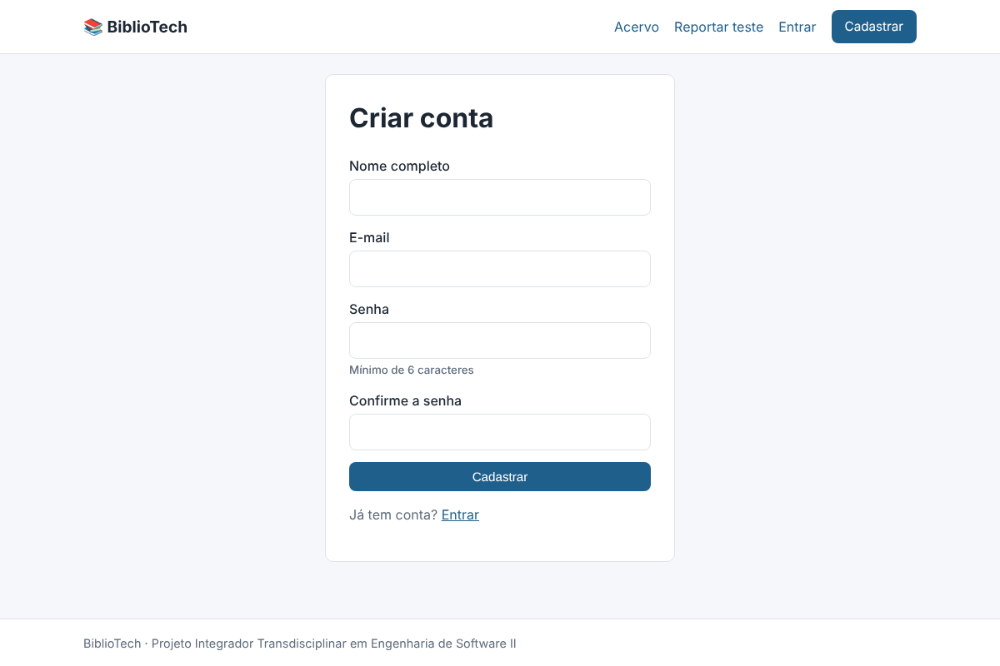
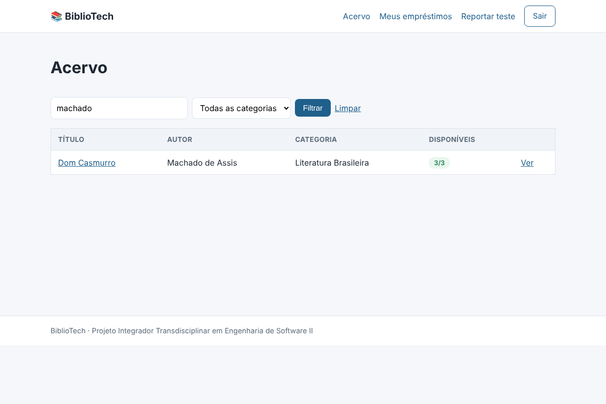
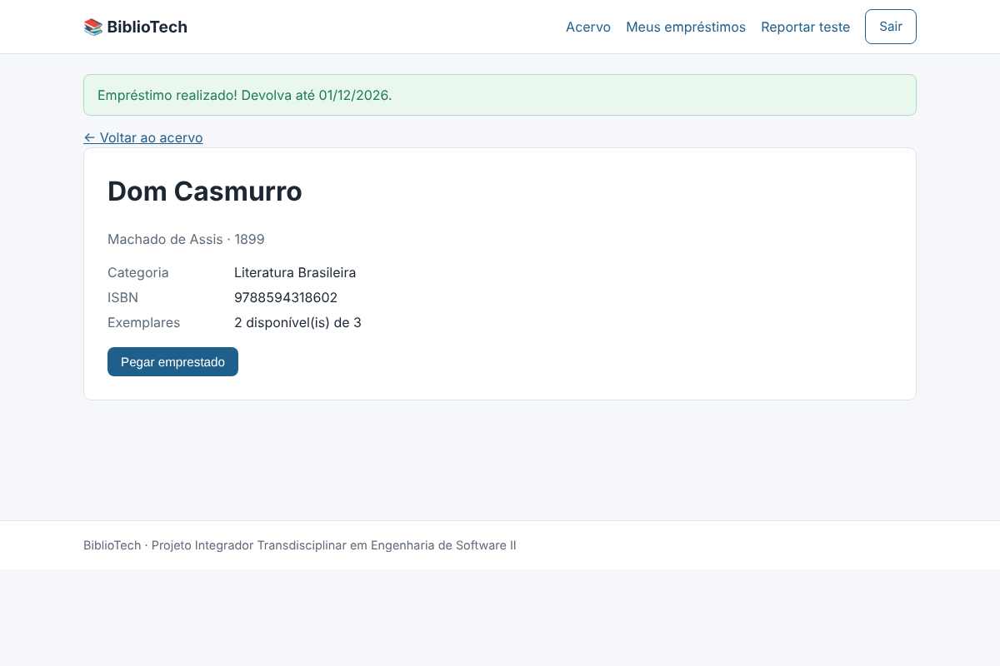
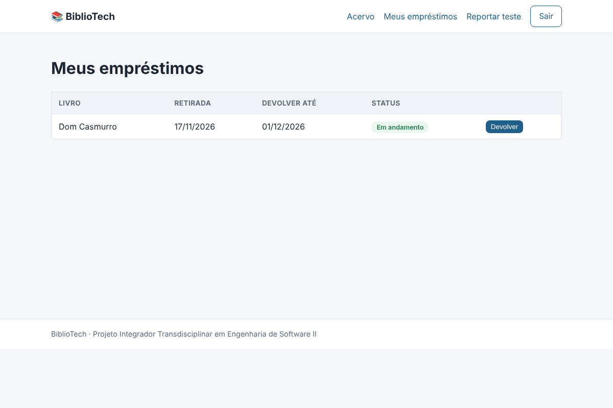
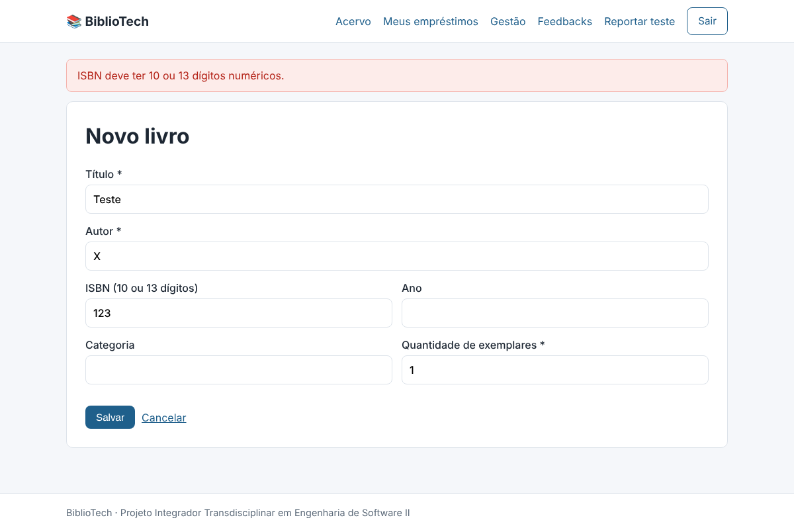
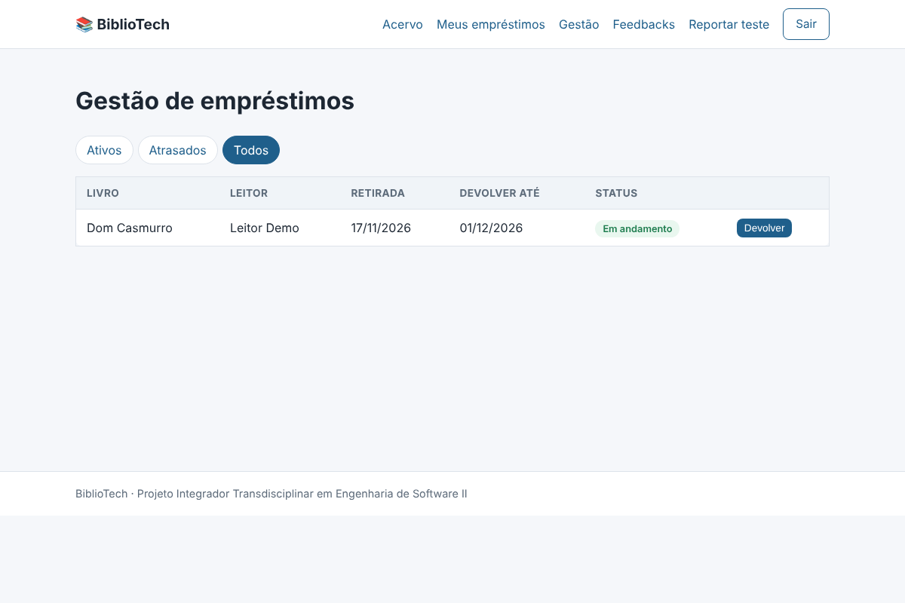
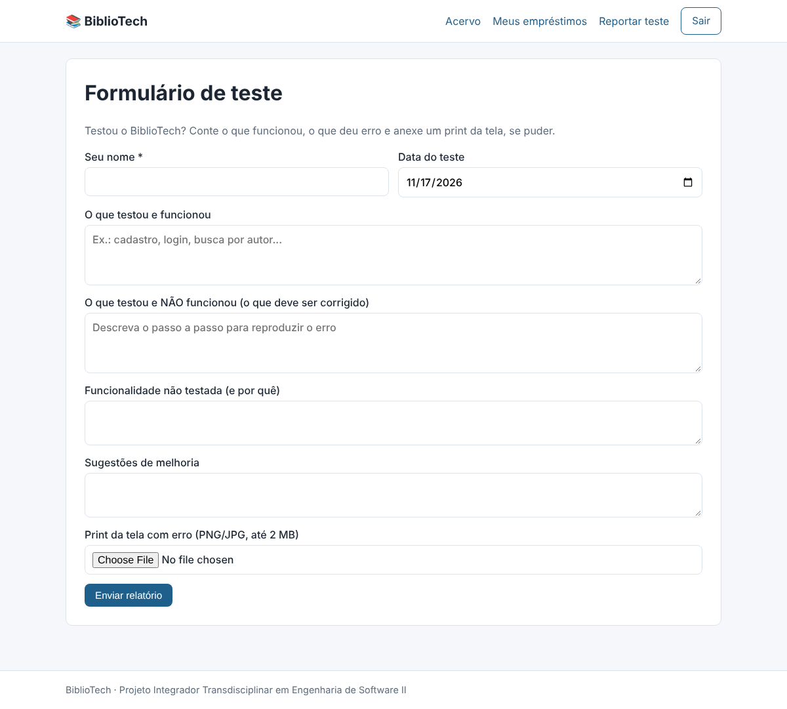

# Manual de uso: BiblioTech

## Para leitores

### Criar conta
1. Clique em **Cadastrar** no canto superior direito.
2. Preencha nome, e-mail e senha (mínimo de 6 caracteres) e confirme a senha.
3. Clique em **Cadastrar**. Você será levado à tela de login.

### Encontrar um livro
1. Clique em **Acervo**, ou use a busca na página inicial.
2. Digite parte do título ou do autor e clique em **Filtrar**. Também dá para escolher uma categoria.
3. A etiqueta verde mostra quantos exemplares estão disponíveis (ex.: `2/3`).

### Pegar um livro emprestado
1. Abra o livro e clique em **Pegar emprestado**.
2. A data de devolução aparece na mensagem verde (14 dias depois).

Regras: no máximo 3 livros ao mesmo tempo, e quem tem livro atrasado precisa devolvê-lo antes de pegar outro.

### Acompanhar e devolver
1. Clique em **Meus empréstimos**.
2. O status aparece como *Em andamento*, *Atrasado* (vermelho) ou *Devolvido*.
3. Para devolver, clique em **Devolver** e confirme.

## Para administradores

### Cadastrar livro
1. Em **Acervo**, clique em **+ Novo livro**.
2. Título, autor e quantidade são obrigatórios. O ISBN precisa ter 10 ou 13 dígitos.
3. Para corrigir um livro, abra-o e clique em **Editar**. A exclusão só é permitida para livros que nunca foram emprestados.

### Gestão de empréstimos
Em **Gestão**, alterne entre as abas *Ativos*, *Atrasados* e *Todos*. Também é possível registrar a devolução de qualquer leitor por ali.

### Feedbacks dos testadores
Em **Feedbacks**, veja os relatórios enviados pelo formulário de teste, abra os prints e mude o status para *Corrigido* ou *Descartado*.

## Para testadores
Acesse **Reportar teste** (não precisa de login), preencha o que funcionou, o que falhou e o que não testou, e anexe um print se encontrar erro.

